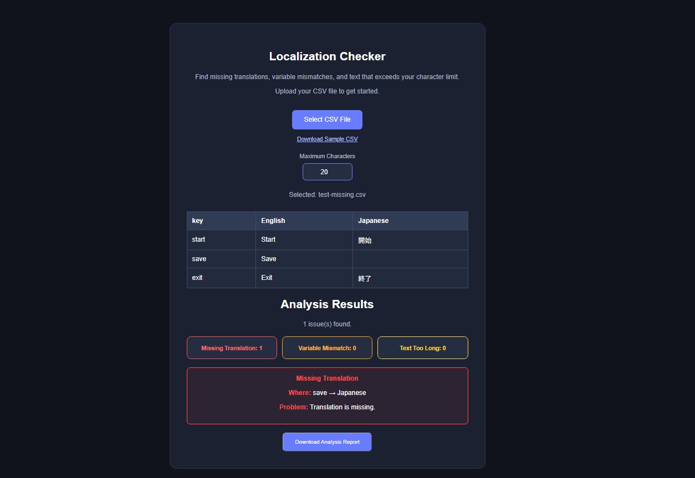

# IndiePilot

**Catch localization issues before they reach your players.**

IndiePilot is a free, browser-based CSV localization checker for indie game developers.

Quickly identify missing translations, inconsistent variables, and text that exceeds your character limit — without installing any software.

### 🚀 Try IndiePilot

**[Launch IndiePilot](https://indiepilot-dev.github.io/IndiePilot/)**

No account or installation required.

## Screenshot



## Why IndiePilot?
Localization mistakes can cause confusing dialogue, broken placeholders, and text that doesn't fit your game's interface.

IndiePilot helps you spot common problems early, so you can spend less time manually reviewing CSV files.

## Features

- **Missing Translation Detection:** Identify empty translation cells.
- **Variable Mismatch Detection:** Find inconsistent placeholders such as `{player_name}` and `{player}`.
- **Character Limit Checking:** Detect Japanese text that exceeds your chosen character limit.
- **CSV Preview:** Review your localization data in a readable table.
- **Downloadable Reports:** Export detected issues as a CSV file.
- **Sample CSV:** Get started quickly with an example file.

## How It Works

1. Open [IndiePilot](https://indiepilot-dev.github.io/IndiePilot/).
2. Download the sample CSV or prepare your own localization file.
3. Select your CSV file.
4. Set your preferred character limit.
5. Review detected localization issues.
6. Download the analysis report if needed.

## CSV Format

IndiePilot currently requires the following columns:

`key,English,Japanese`

Example:

```csv
key,English,Japanese
start,Start,開始
save,Save,保存
welcome,Welcome {player_name}!,ようこそ {player_name}！
```

CSV files can contain quoted commas and line breaks.

Maximum file size: **5 MB**.

## Privacy

Your CSV files are processed locally in your browser. The IndiePilot application does not upload their contents to an IndiePilot server.

Learn more in our [Privacy Policy](https://indiepilot-dev.github.io/IndiePilot/privacy.html).

## Current Limitations

- Currently designed primarily for English-to-Japanese localization.
- Character limit checks apply to the Japanese column.
- Character counts are based on Unicode code points, which may differ from how text occupies space in a game UI.
- IndiePilot checks localization issues but does not automatically translate text.

## Built With

- HTML
- CSS
- JavaScript

## Project Status

**Early development — feedback welcome!**

IndiePilot is an evolving project focused on making localization quality checks simpler for independent game developers.

Future improvements may include additional languages, more flexible CSV formats, and expanded validation options.
